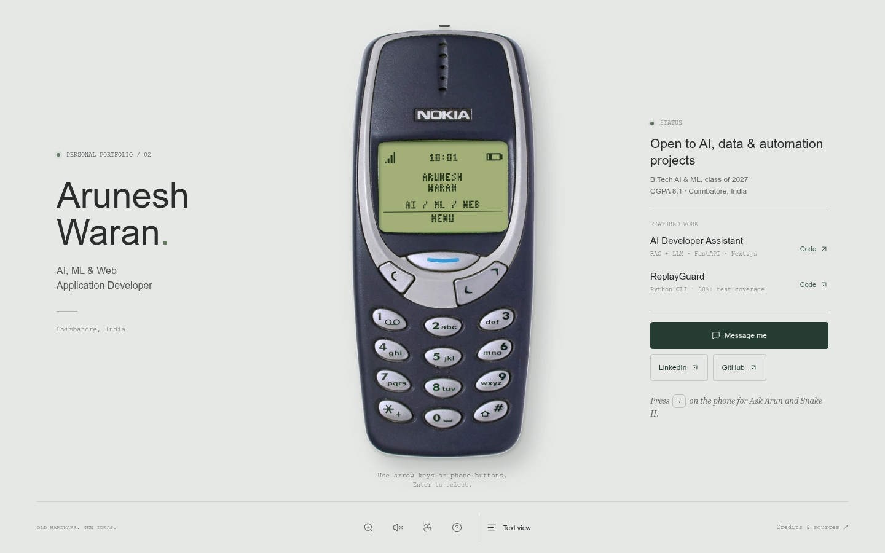
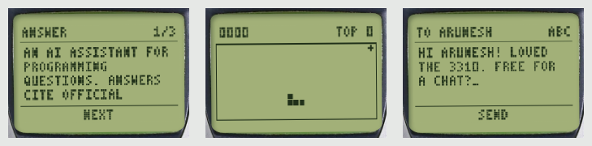

# Arunesh Waran: portfolio on a Nokia 3310

An interactive portfolio: browse projects, skills and education on a working Nokia 3310, with an accessible text view for everyone else.





## What's on the phone

| Key | Section |
| --- | --- |
| 1-6 | About, Projects, Skills, Education, Certificates, Contact |
| 7 | Extras: **Ask Arun** (in-browser BM25 Q&A over this portfolio) and **Snake II** |
| 8 / 9 | Help / Phone info |
| 0 | Home |
| `*` / `#` | Sound / reduced motion |

- **Messages**: Contact > Write message. Multi-tap typing on the keypad, or a regular keyboard.
- **Ask Arun**: suggested questions or free text. Answers are retrieved from `src/content.js`, show their source, and open the matching section.
- **Snake II**: 2 4 6 8 or the arrow keys. Top score is saved locally.
- **Deep links**: every screen has a URL, e.g. `#projects/ai-assistant/topics/0`, `#app/snake`, `#app/message`.
- **Accessibility**: keyboard control, screen-reader announcements, reduced motion, and a full [text view](text.html).

## Configure

Edit `src/config.js`:

- `formEndpoint`: paste a [Formspree](https://formspree.io) form URL to receive phone messages by email. Without one, the message is copied and LinkedIn opens.
- `email`: alternative to a form; opens the visitor's mail app.
- `resumePath`: add `resume.pdf` to the repo and set `"./resume.pdf"` to show Resume buttons.

After changing content or `resumePath`, run `npm run build:text` to regenerate `text.html`.

When the new domain is ready, update `CNAME` and, if you like, point `og:image` in `index.html` and `scripts/build-text.mjs` at the new domain.

## Develop

No build step and no dependencies: plain ES modules served as static files (GitHub Pages).

```bash
npm start            # http://localhost:8000
npm test             # unit tests + text.html freshness check
npm run build:text   # regenerate text.html from src/content.js
```

```
index.html            phone page + quick view
text.html             generated accessible view
src/content.js        all portfolio content (single source of truth)
src/navigation.js     phone state machine + URL routing
src/apps.js           Messages, Ask Arun, Snake II
src/ask.js            BM25 retrieval
src/t9.js, snake.js   multi-tap input, game logic
src/lcd.js            84 x 48 renderer and pixel font
tests/                node:test suites (run in GitHub Actions)
```

## Credits

Handset photo: Rainer Knäpper (smial), retouched by Multicherry, [Free Art License 1.3](https://artlibre.org/licence/lal/en/). Lucide icons (ISC). Independent portfolio, not affiliated with Nokia. Full credits in the [text view](text.html#credits).
